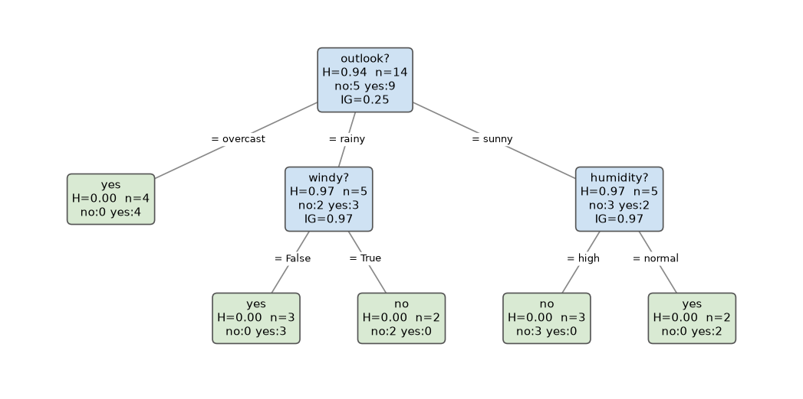
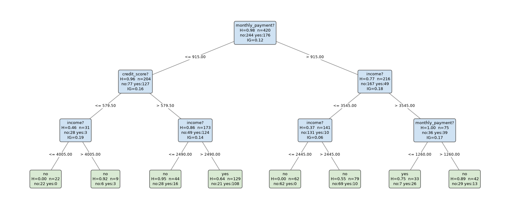

# Report: decision tree from scratch with entropy and information gain

**GitHub repository:** https://github.com/kranos212/Decision-tree
**PyPI package:** https://pypi.org/project/entropy-tree/ (`pip install entropy-tree`)

## 1. Goal

Build a decision tree classifier from scratch (no scikit-learn), with:

| Requirement | Status |
|---|---|
| Split selection with entropy and information gain | ✅ `entropy_tree/tree.py` |
| Hyperparameters for the size of the tree | ✅ `max_depth`, `min_samples_split`, `min_samples_leaf`, `min_information_gain`, `max_leaf_nodes` |
| Bonus: display the tree | ✅ text (`print_tree`), matplotlib (`plot`), Graphviz (`to_dot`) |
| Bonus: package on PyPI | ✅ packaged as `entropy-tree` (`pyproject.toml`) |

The only dependencies are `numpy` and `pandas`. `matplotlib` is optional and only needed for `plot()`.

## 2. How the algorithm works

### Entropy and information gain

For a set of labels $S$ with class proportions $p_c$:

$$H(S) = -\sum_c p_c \log_2 p_c$$

A split divides $S$ into children $S_1, \dots, S_k$. Its information gain is the entropy of the parent minus the size-weighted entropy of the children:

$$IG(S) = H(S) - \sum_{i} \frac{|S_i|}{|S|} H(S_i)$$

At each node the tree tries every feature and keeps the split with the highest gain.

### Split types

- **Categorical feature** (text or boolean column): multiway split, one branch per category (ID3 style). One vectorised count table per feature gives its gain.
- **Numeric feature**: binary split `x <= t`. The values are sorted once, cumulative class counts give the left/right counts at every possible cut, and every midpoint between two distinct consecutive values is a candidate threshold. All candidates are scored in one pass (O(n log n) per feature) instead of re-partitioning the data for each threshold.

### Stopping rules (the size hyperparameters)

A node becomes a leaf (predicting its majority class) when any of these holds:

| Hyperparameter | Rule |
|---|---|
| `max_depth` | the node is at the maximum depth (the root is at depth 0) |
| `min_samples_split` | the node has fewer samples than this |
| `min_samples_leaf` | no split leaves at least this many samples in every child |
| `min_information_gain` | the best split's gain is below this value |
| `max_leaf_nodes` | the leaf budget is used up. With this option the tree is grown **best-first**: the candidate split with the largest weighted gain `n_samples × IG` is always expanded next. |

A pure node (entropy 0) is never split.

### Prediction

Rows are routed down the tree in vectorised batches (the index array is partitioned at each node, not looped row by row). A leaf returns its class distribution, which gives `predict_proba`. `predict` returns the most likely class. A category that never appeared in training stops at the current node and uses that node's class distribution.

The tree also computes `feature_importances_`: the information gain a feature produced, weighted by node size and normalised to sum to 1.

## 3. Code structure

```
Decision-tree/
├── src/entropy_tree/
│   ├── tree.py          # entropy, information_gain, Node, DecisionTreeClassifier, any_df_decision_tree
│   ├── utils.py         # train_test_split, accuracy_score, confusion_matrix, dataset loaders
│   └── datasets/        # play_tennis.csv, loan_approval.csv
├── examples/
│   ├── demo.py              # full walkthrough (python examples/demo.py --plot)
│   └── make_loan_dataset.py # regenerates the synthetic loan dataset
├── tests/test_tree.py   # 14 unit tests (python -m unittest discover -s tests)
├── docs/                # tree images used in this report
├── pyproject.toml       # packaging metadata for PyPI
└── README.md
```

The first version (`decision_tree.py`) had a placeholder `any_df_decision_tree(data, target_column)` that split on the median of the target. It is now a real function that builds a tree. It still takes `(data, target_column)`, and also accepts any hyperparameter as a keyword argument.

## 4. Datasets and results

### 4.1 Play tennis (14 rows, categorical)

This is the classic ID3 example from Quinlan, so the results can be checked against the textbook values:

| Feature | Information gain |
|---|---|
| outlook | **0.247** |
| humidity | 0.152 |
| windy | 0.048 |
| temperature | 0.029 |

The entropy of the target is 0.940 bits. The learned tree matches the textbook: `outlook` at the root, `overcast` is a pure *yes* leaf, `sunny` is split on `humidity` and `rainy` on `windy`. That gives depth 2, 5 leaves, and 100% training accuracy. The unit tests check these numbers.



### 4.2 Loan approval (600 rows, numeric + categorical)

This is a synthetic dataset (`examples/make_loan_dataset.py`, seed 42). The features are `age`, `income`, `credit_score`, `monthly_payment`, `employment` and `guarantor`. The label follows known rules (credit score ≥ 580, income ≥ 3 × monthly payment, unemployed applicants need a guarantor), and 5% of labels are flipped at random as noise. Because the rules are known, we can check what the tree learned.

The data was split into 70% train and 30% test, and the training part was split again into fit and validation sets. `max_depth` was chosen on the validation set only:

| max_depth | leaves | fit acc | val acc |
|---|---|---|---|
| 1 | 2 | 0.708 | 0.676 |
| 2 | 4 | 0.765 | 0.743 |
| 3 | 8 | 0.829 | 0.810 |
| 4 | 14 | 0.867 | 0.857 |
| 5 | 21 | 0.908 | 0.848 |
| **6** | 31 | 0.940 | **0.867** |
| 8 | 44 | 0.978 | 0.857 |
| None | 52 | 1.000 | 0.838 |

Training accuracy keeps rising up to 100% as the tree memorises the label noise, but validation accuracy peaks at depth 6 and then falls. **Limiting the size of the tree prevents overfitting.**

With `max_depth=6` retrained on the full training set, **test accuracy is 0.906**:

| | predicted no | predicted yes |
|---|---|---|
| **true no** | 89 | 11 |
| **true yes** | 6 | 74 |

Feature importances: income 0.37, monthly_payment 0.26, credit_score 0.19, employment 0.13, age 0.03, guarantor 0.03. The three features in the real rules come first, and `age`, which plays no role in the label, is near zero. `guarantor` is low because it only matters for the small group of unemployed applicants.

A smaller tree is easier to read (`max_depth=3, min_samples_leaf=5`, test accuracy 0.850). Its splits follow the real rules: `credit_score <= 579.5` (true cut-off: 580), and several income / monthly payment cuts that approximate the diagonal rule `income ≥ 3 × payment`:



## 5. Limitations and possible improvements

- Every split tests one feature against one threshold, so a rule like `income ≥ 3 × payment` takes many splits to approximate. Adding a ratio feature would capture it in one split.
- Information gain favours categorical features with many values, because multiway splits on them score well. The *gain ratio* (C4.5) corrects this and would be a small change in `_categorical_split`.
- There is no pruning after training. Reduced-error or cost-complexity pruning could remove splits whose children predict the same class (one such split appears in the loan tree).
- Missing values are rejected at `fit` and must be imputed beforehand.
- Only classification is implemented. Regression would use variance instead of entropy.

## 6. How to reproduce

```bash
git clone https://github.com/kranos212/Decision-tree.git
cd Decision-tree
pip install -e ".[plot]"
python -m unittest discover -s tests   # 14 tests
python examples/demo.py --plot         # prints everything above, saves the PNGs
```

To publish a new version on PyPI:

```bash
pip install build twine
python -m build
twine upload dist/*
```
